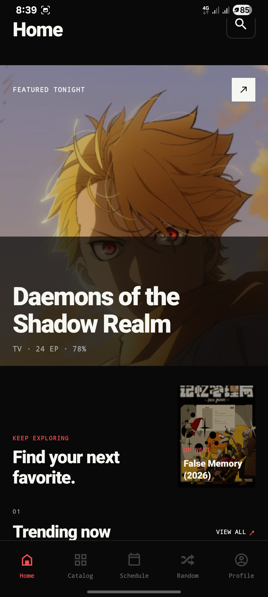
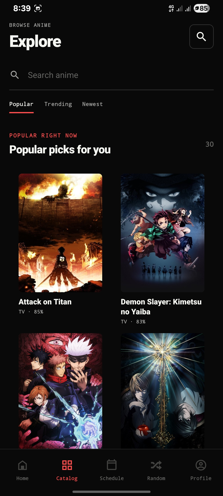

<div align="center">
  

  <br><br>

  # Animekz Android

  <p>
    <i>A quiet anime companion for your phone</i>
  </p>

  <p>
    <a href="https://github.com/Kagunex/Animekx-App/releases/latest">
      
    </a>
    <a href="https://github.com/Kagunex/Animekx-App/releases/latest">
      
    </a>
    
    
  </p>
  <br>
  <a href="https://github.com/Kagunex/Animekx-App/releases/latest">Download APK</a>
  &nbsp;
  <a href="https://github.com/Kagunex/Animekx-App">App Site</a>
  &nbsp;
  <a href="https://github.com/Kagunex/Animekx-App/releases/latest">v1.0.0 Notes</a>
  &nbsp;
  <a href="./SUPPORT.md">SUPPORT ANIMEKX</a>
</div>
<br>

---

### How Animekz Compares

| Feature | Animekz | Old Anilab | [Th3-Anime](https://github.com/Th3-Anime/Th3-Anime) | AniStream | [Anymex](https://github.com/RyanYuuki/AnymeX) |
|:--|:--:|:--:|:--:|:--:|:--:|
| **Open Source** | Yes | No | No | No | No |
| **Multi-Provider** | Yes | Yes | Yes | Limited | Yes |
| **Skip Intro/Outro** | Yes (AniSkip) | Yes | No | No | No |
| **Quality Selection** | Auto + Manual | Auto only | Manual | Manual | Auto |
| **Subtitle Customization** | Font, Size, BG, Outline | Basic | Basic | None | Basic |
| **Download/Offline** | Yes | Yes | No | No | Yes |
| **PiP (Picture-in-Picture)** | Yes | Yes | No | No | No |
| **Sleep Timer** | Yes | No | No | No | No |
| **Volume/Brightness Gestures** | Yes | Yes | No | No | Partial |
| **Hold for 2x Speed** | Yes | No | No | No | No |
| **Server Fallback Chain** | Yes (4-layer) | No | No | No | No |
| **Episode Notifications** | Yes (stream-verified) | Yes | No | No | Partial |
| **MAL/AniList Sync** | Yes | Yes | No | No | No |
| **Watch Statistics** | Yes | No | No | No | No |
| **Recommendations** | Yes | No | No | No | Partial |
| **Notify Me (per-anime)** | Yes | No | No | No | No |
| **Onboarding Flow** | Yes | No | No | No | No |
| **NSFW Toggle** | Yes | Yes | No | No | No |
| **Episode Thumbnails** | Yes (TMDB) | Yes | No | No | Partial |
| **Comments/Ratings** | Yes | No | No | No | No |
| **Bookmark Sync** | Yes (cloud) | Local only | No | No | Local |
| **Design System** | "Nothing" (custom) | Material | Basic | Basic | Material |

---

### Animekz Android

Reliability, trust, and legal refresh: Random fixed at the root (pool pages capped for AniList's 5,000-entry depth limit with auto-recovery), Home rails restored (valid `FINISHED` filter, shimmer placeholders), deep-link-safe search, no more infinite loaders on bad links, self-healing avatars, 18+ gate on NSFW, hardened account deletion, comment fixes, and a full DMCA/Privacy/Terms refresh.

| APK |
|:--|
| [Latest APK](https://github.com/Kagunex/Animekx-App/releases/latest) |
| [Latest APK](https://github.com/Kagunex/Animekx-App/releases/latest) |
| [Latest APK](https://github.com/Kagunex/Animekx-App/releases/latest) |

<sub>The universal APK contains all architectures · Enable *install from unknown sources* if prompted &middot; Android 9.0+</sub>

---

### Coming Soon

| Feature | Status | Notes |
|:--|:--|:--|
| **Watch Party** | Planned | Social co-watching with synced playback. Requires backend infrastructure and real-time sync layer. |
| **Chromecast/Casting** | Planned | Google Cast SDK integration for TV playback. |
| **Background Audio** | Planned | Listen to anime audio while the app is backgrounded. |
| **Light Theme** | Planned | Full light mode with the same "Nothing" design language. |

---

### Support Animekz

Animekz is open source. Voluntary support helps fund **hosting, releases, and open-source development** and never changes access to app features.

| Option | Details |
|:--|:--|
| Patreon | [ShoIslam](https://patreon.com/ShoIslam) |
| Binance | UID `1098400042` (Binance Pay) |
Read the full [Support Guide](./SUPPORT.md).

### Screenshots

<p align="center">
  
  &nbsp;
  
  &nbsp;
</p>

---

### How to install

1. Open the [latest release](https://github.com/Kagunex/Animekx-App/releases/latest)
2. Download the APK (`arm64`, `arm32`, or `universal` — universal contains all architectures).
3. Install

**Note:** If you had an older alpha under `animekx.anine.app`, please uninstall it first. Android sees them as different apps.

Full info at [Animekz-App](https://github.com/Kagunex/Animekx-App)

---

### For builders

Expo + React Native with a native playback layer.

```bash
pnpm install
pnpm dev
```

Build the server:
```bash
pnpm build
pnpm start
```

Please read [CONTRIBUTING.md](CONTRIBUTING.md) before opening a PR.
Design notes in [`design.md`](design.md).

---

### Gentle notes

- Backend runs on a free cloud instance, so discovery can be slower during busy hours
- Providers can come and go
- Only use media you are allowed to watch
- Read [TERMS.md](TERMS.md) | [PRIVACY.md](PRIVACY.md) | [SECURITY.md](SECURITY.md)

<br>

<div align="center">
  <sub>
    Made with care &middot; Android 9+ &middot; Open source under the [MIT License](./LICENSE)<br>
    <i>Animekz &middot; a quiet place for anime</i><br>
    The Animekz name and icon aren't covered by the license — please don't distribute copies that present themselves as Animekz.
  </sub>
</div>
